<div align="center">

# 🛋️ Couch Critics

**Deem nota a filmes, séries, jogos, livros, animes e músicas com a sua comunidade e combinem a próxima noite de filme.**

Um app gratuito e de código aberto para o [Root](https://www.rootapp.com). Todo mundo dá nota, todo mundo vê as notas e a turma decide junta o que ver ou jogar a seguir.

[](LICENSE)
[](https://github.com/MatheusBonat/couch-critics-source/releases)
[](https://github.com/MatheusBonat/couch-critics-source/commits/main)


[Funções](#-funções) · [Prints](#%EF%B8%8F-prints) · [Novidades](#-novidades) · [Configurar](#-configurar) · [Para desenvolvedores](#-para-desenvolvedores) · [Changelog](CHANGELOG.md) · [English](README.md)

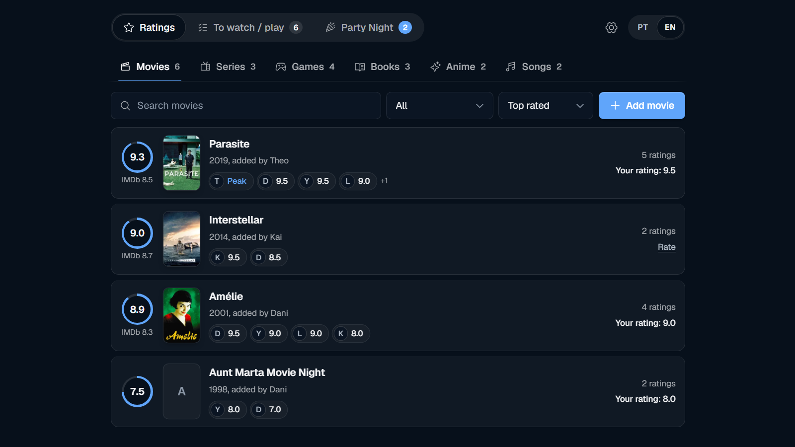

</div>

> O Couch Critics é um projeto independente. Não é um app oficial do Root e não é patrocinado, apoiado nem certificado pelo Root, TMDB, OMDb, IGDB, Twitch, Open Library, AniList ou MusicBrainz. Veja [NOTICE.md](NOTICE.md).

## ✨ Funções

**Dar nota juntos**
- Notas de 0 a 10 em meios pontos, com comentário opcional e botão de emojis. Duas notas especiais: **Peak** (conta 10) e **Fundo do poço** (conta 0)
- Uma nota por membro por título. Cada linha mostra a média, a nota do IMDb e a nota dos primeiros membros
- Reações com emoji nas notas dos outros, comentários com spoiler e nota por episódio nas séries e nos animes

**Achar e adicionar títulos**
- Busca com capa, sinopse e gêneros, em português ou inglês: filmes e séries (TMDB), jogos (IGDB) e, opcionalmente, livros (Open Library), animes (AniList) e músicas (MusicBrainz), que não precisam de chave de API
- Importe suas notas antigas de uma planilha (CSV) e exporte as suas

**Decidir o que vem a seguir**
- **Para ver / jogar**: a lista da turma com tudo que alguém quer ver, jogar, ler ou ouvir, mostrando quem quer cada um. O que você já terminou vai para o fim da sua lista, em "Concluídos"
- **Party Night**: combine uma noite de filme ou jogo. Escolha de 2 a 8 títulos, defina o prazo da votação, todo mundo vota (os votos são abertos) e diz se vai. O vencedor vira uma noite marcada, e as notificações do Root lembram quem vai

**Conhecer a turma**
- Quem pensa parecido com você, os títulos que racham o grupo, o seu ano em notas e o Hall da fama e da vergonha

**Feito para comunidades**
- Português e inglês, tema claro e escuro (acompanha o tema do Root), telas estreitas e atualização ao vivo para todos
- Os admins escolhem quem configura o app, podem remover comentários e títulos e ligar ou desligar as categorias opcionais
- Sem anúncios, sem análise de uso e sem rastreamento. O desenvolvedor nunca vê os dados de uma comunidade

Todos os detalhes estão em [docs/funcionalidades.pt.md](docs/funcionalidades.pt.md).

## 🖼️ Prints

### Dar nota juntos

<table>
<tr>
<td width="50%" valign="top">

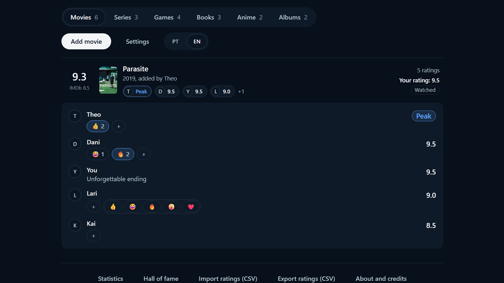<br>
<b>Uma nota por membro, com reações</b><br>
<sub>Reações com emoji nas notas dos outros e comentário opcional em cada nota.</sub>

</td>
<td width="50%" valign="top">

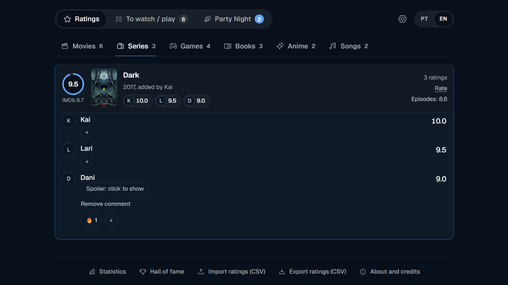<br>
<b>Spoilers escondidos</b><br>
<sub>Marque o comentário como spoiler e ele só abre quando alguém clica.</sub>

</td>
</tr>
<tr>
<td width="50%" valign="top">

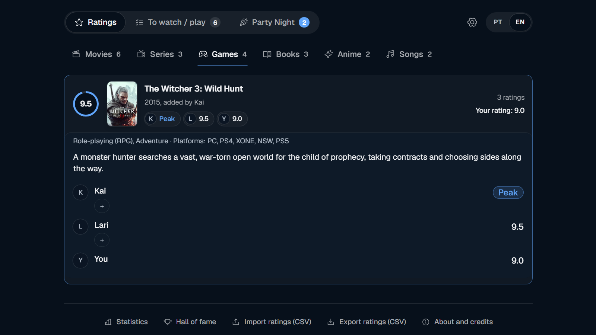<br>
<b>Sinopse, gêneros e plataformas</b><br>
<sub>Em português ou inglês, direto das fontes de dados.</sub>

</td>
<td width="50%" valign="top">

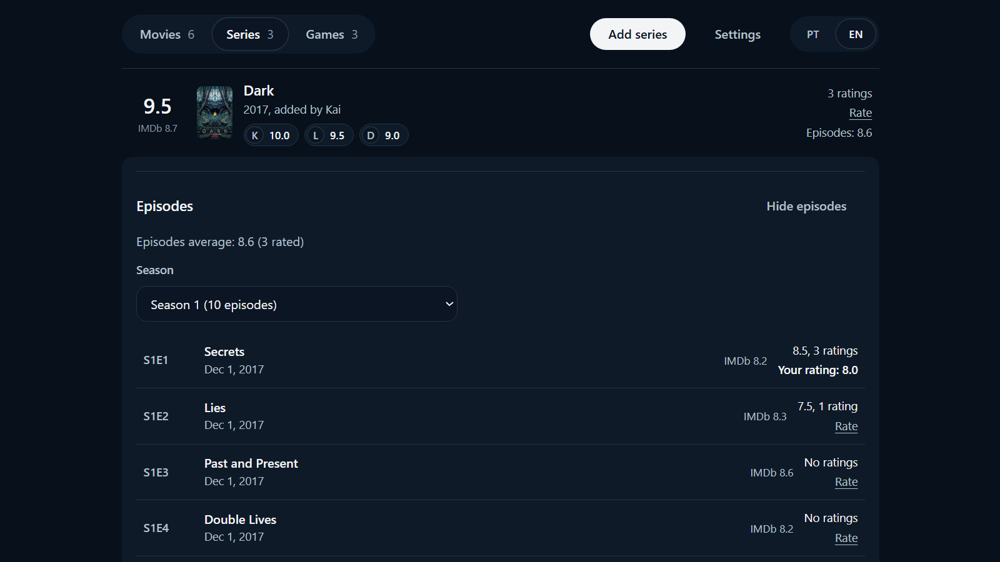<br>
<b>Séries, episódio por episódio</b><br>
<sub>Uma nota geral e, se quiser, uma para cada episódio.</sub>

</td>
</tr>
</table>

### Achar e adicionar títulos

<table>
<tr>
<td width="33%" valign="top">

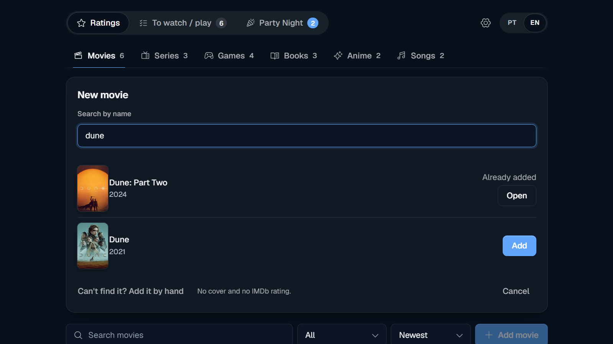<br>
<b>Busca com capas</b><br>
<sub>Filmes, séries, jogos, livros, animes e músicas, em português ou inglês. Não achou? Adicione à mão.</sub>

</td>
<td width="33%" valign="top">

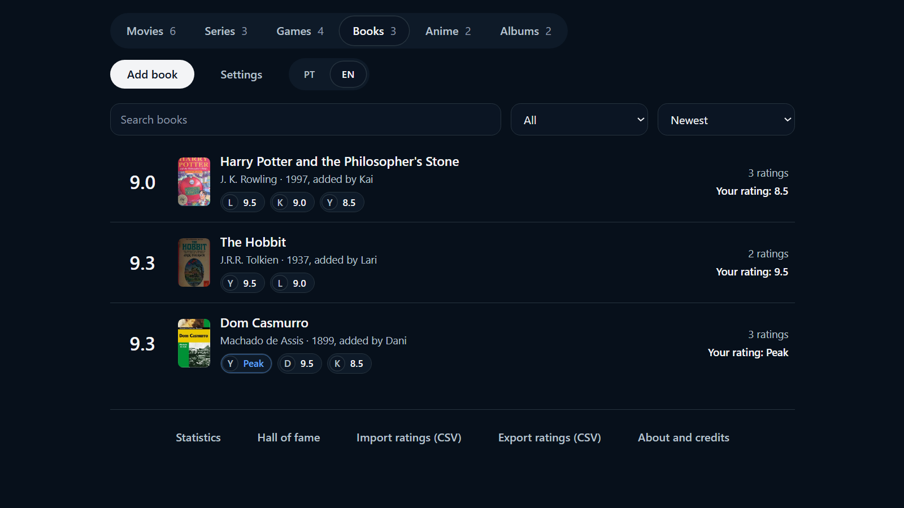<br>
<b>Livros, animes e músicas</b><br>
<sub>Categorias opcionais que não precisam de chave de API: o admin liga em Configurações.</sub>

</td>
<td width="33%" valign="top">

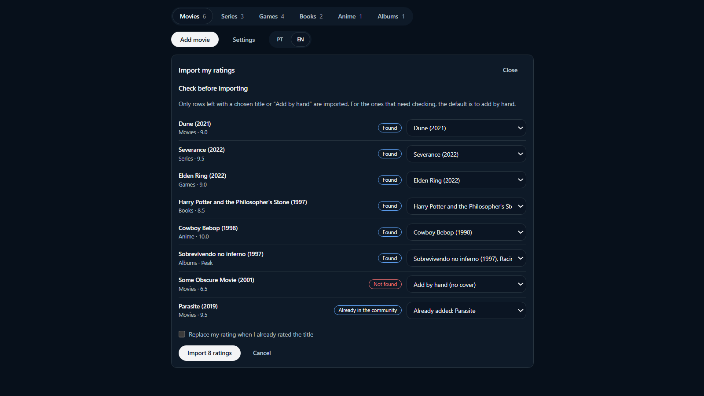<br>
<b>Traga suas notas antigas</b><br>
<sub>Escolha um CSV, confira os pares e importe. Dá para exportar as suas também.</sub>

</td>
</tr>
</table>

### Decidir o que vem a seguir

<table>
<tr>
<td width="50%" valign="top">

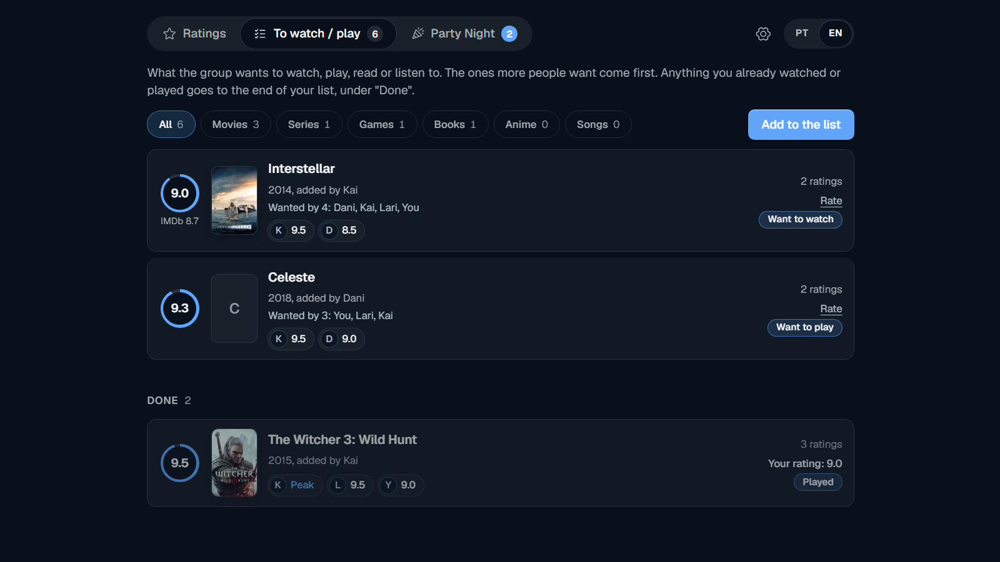<br>
<b>Para ver / jogar</b><br>
<sub>O que cada um quer ver, jogar, ler ou ouvir, com quem quer cada título. Já fez? Ele vai para o fim da sua lista.</sub>

</td>
<td width="50%" valign="top">

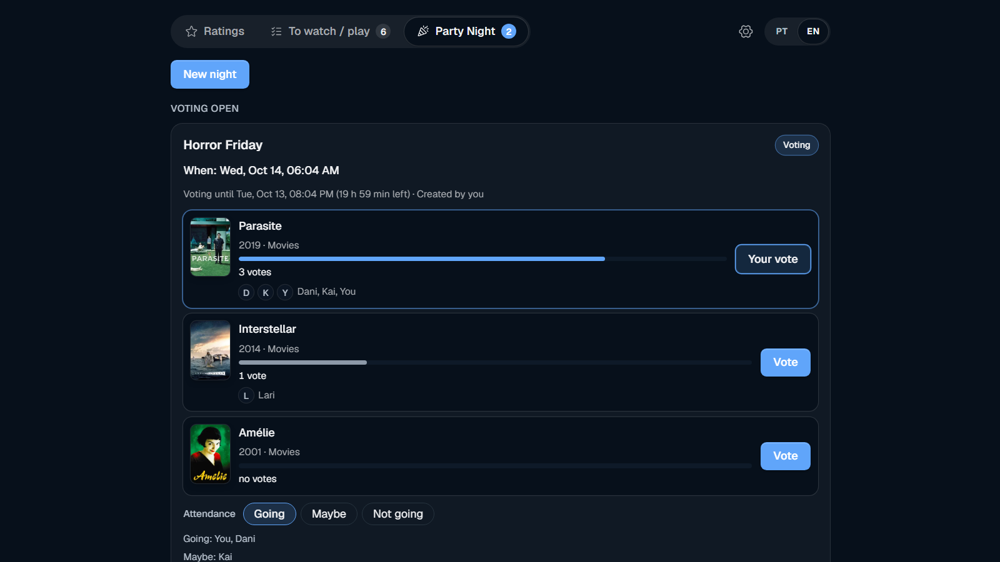<br>
<b>Party Night: vote e diga se vai</b><br>
<sub>Escolha de 2 a 8 títulos, defina um prazo, todo mundo vota (os votos são abertos) e responde Vou / Talvez / Não vou.</sub>

</td>
</tr>
<tr>
<td width="50%" valign="top">

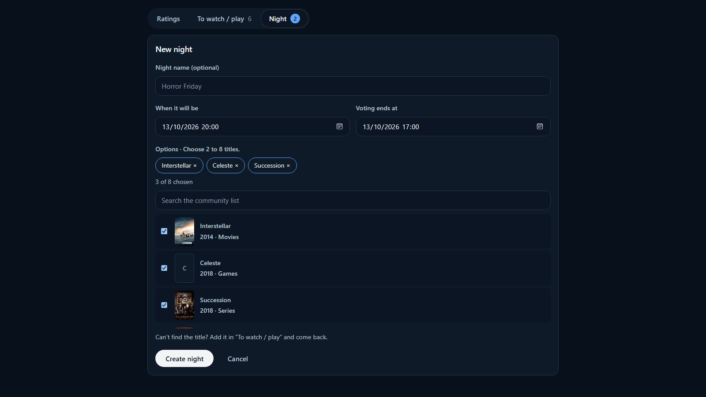<br>
<b>Qualquer membro pode combinar uma noite</b><br>
<sub>Nome, data, prazo da votação e títulos da lista da comunidade.</sub>

</td>
<td width="50%" valign="top">

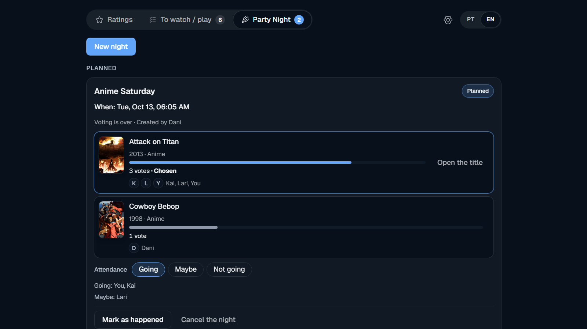<br>
<b>O vencedor vira uma noite marcada</b><br>
<sub>Empate é desfeito por quem criou. Depois da noite, marque como visto e dê a nota.</sub>

</td>
</tr>
</table>

### Conhecer a turma

<table>
<tr>
<td width="33%" valign="top">

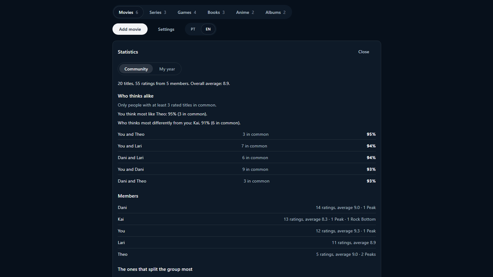<br>
<b>Quem pensa parecido com você</b><br>
<sub>Compatibilidade entre membros, os títulos que racham o grupo e como as notas se distribuem.</sub>

</td>
<td width="33%" valign="top">

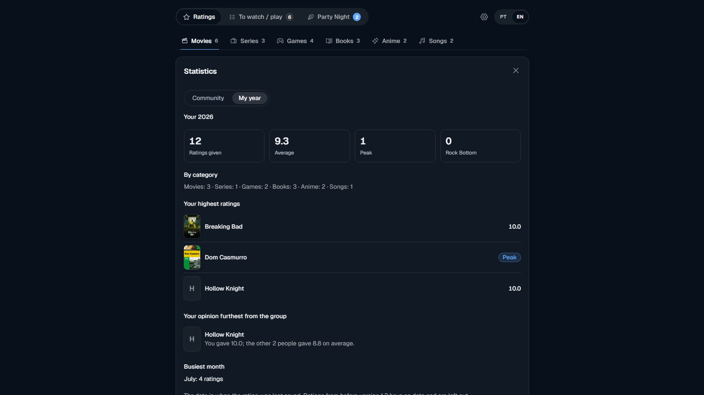<br>
<b>Seu ano em notas</b><br>
<sub>Notas dadas, média, favoritos e o mês mais movimentado.</sub>

</td>
<td width="33%" valign="top">

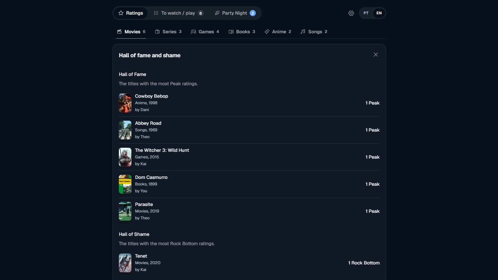<br>
<b>Hall da fama e da vergonha</b><br>
<sub>Os títulos com mais notas Peak e mais notas Fundo do poço.</sub>

</td>
</tr>
</table>

### Bonito em qualquer lugar

<table>
<tr>
<td width="50%" valign="top">

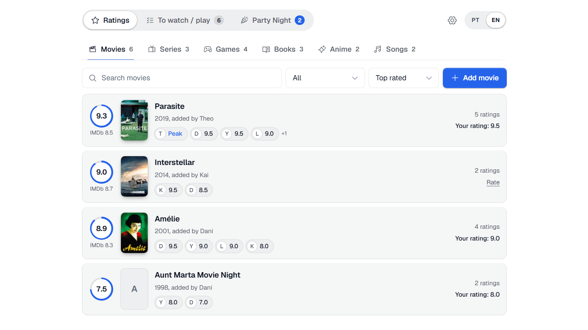<br>
<b>Claro e escuro</b><br>
<sub>Acompanha o tema do seu app do Root.</sub>

</td>
<td width="50%" valign="top">

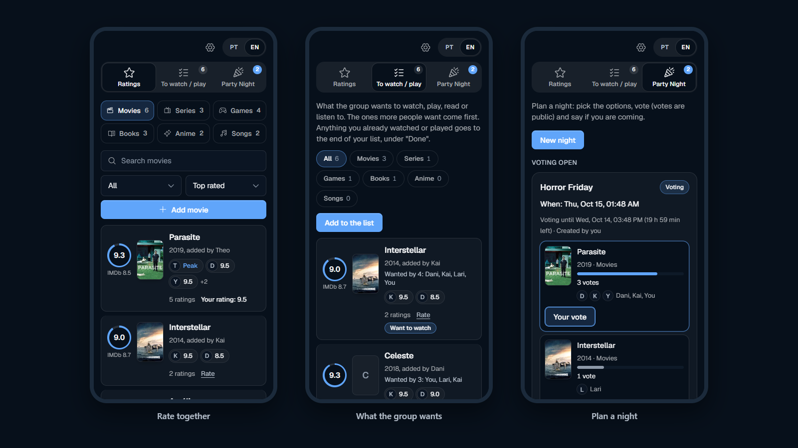<br>
<b>Feito para telas estreitas</b><br>
<sub>O mesmo app no celular: notas, a lista da turma e uma noite.</sub>

</td>
</tr>
</table>

<sub>Os prints usam títulos de exemplo e nomes de membros inventados (e estão em inglês). As capas vêm do TMDB.</sub>

## 🆕 Novidades

**2.3.0**: visual novo, e cada botão leva para onde diz (os painéis abertos fecham quando você troca de categoria ou de tela). **2.2.1**: as capas aparecem dentro do Root, a categoria **Músicas** e a noite virou **Party Night**. **2.2.0**: a lista **Para ver / jogar** e a **Party Night**, para decidir juntos o que ver ou jogar. **2.0.1**: a lista de títulos é paginada e continua funcionando com centenas de títulos. **2.0.0**: livros, animes e músicas e importação de planilha.

Veja o [CHANGELOG](CHANGELOG.md) (em inglês) e as [releases](https://github.com/MatheusBonat/couch-critics-source/releases). Clique em **Watch → Custom → Releases** nesta página para ser avisado de cada versão nova.

## 🚀 Configurar

1. Instale o Couch Critics na sua comunidade do Root e escolha, na instalação, quem são os admins do app. O dono da comunidade é sempre admin.
2. Os admins abrem **Configurações** e colam as chaves gratuitas de que precisam (TMDB para filmes e séries, OMDb para a nota do IMDb, IGDB/Twitch para jogos). Livros, animes e músicas não precisam de chave. Sem nenhuma chave o app funciona, só com títulos adicionados à mão.
3. Todo mundo adiciona títulos, dá nota e combina noites.

Passo a passo: [como conseguir as chaves](docs/chaves-de-api.pt.md) e [como configurar](docs/como-configurar.pt.md). Cada comunidade usa as **suas** chaves gratuitas, e o app avisa os admins quando um serviço recusa uma.

## 🧑‍💻 Para desenvolvedores

O Couch Critics é feito com o **SDK do Root**: cliente em TypeScript e React, servidor Node.js e armazenamento em SQLite.

```bash
npm install
npm run build
# dev host: coloque o seu token de desenvolvimento em server/.env (veja server/.env.example) e rode
npm run server   # dentro de server/
npm run client   # dentro de client/
```

O [guia de desenvolvimento](docs/desenvolvimento.pt.md) traz a estrutura do projeto, as fontes de dados, como rodar no dev host do Root, empacotar e enviar a sua versão e o que trocar se você fizer um fork.

## 🤝 Feedback

Achou um erro ou teve uma ideia? [Abra uma issue](https://github.com/MatheusBonat/couch-critics-source/issues/new/choose). Também dá para mandar uma mensagem para **MalphasW** no Root.

## 📄 Licença e créditos

[MIT](LICENSE). Os avisos de terceiros e o que a licença não cobre (o nome e o logo do app e o logo do TMDB) estão em [NOTICE.md](NOTICE.md). A política de privacidade do app publicado está em [docs/privacy-policy.md](docs/privacy-policy.md).

Dados e capas: [TMDB](https://www.themoviedb.org), [OMDb](https://www.omdbapi.com), [IGDB](https://www.igdb.com) (pela Twitch), [Open Library](https://openlibrary.org), [AniList](https://anilist.co), [MusicBrainz](https://musicbrainz.org) e [Cover Art Archive](https://coverartarchive.org). *This product uses the TMDB API but is not endorsed or certified by TMDB.*
